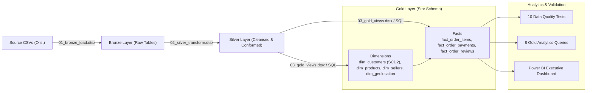

# 🛒 Olist E-Commerce Data Warehouse — SSIS Medallion Architecture

[-FFB000)](#)

An end-to-end, idempotent enterprise Data Warehouse built on **Microsoft SQL Server** and **SQL Server Integration Services (SSIS)** for the [Brazilian E-Commerce Public Dataset by Olist](https://www.kaggle.com/datasets/olistbr/brazilian-ecommerce) (~100k orders across 9 source CSV files, 2016–2018).

The solution ingests raw source extracts into an untouched **Bronze** staging layer, applies cleansing, standardization (`snake_case`), and deduplication in **Silver**, and models a multi-fact **Star Schema** in **Gold**—orchestrated end-to-end from a single master SSIS package (`00_master.dtsx`) with execution logging.

---

## 📋 Table of Contents
1. [Architecture & Data Flow](#1-architecture--data-flow)
2. [Star Schema Dimensional Model](#2-star-schema-dimensional-model)
3. [End-to-End Data Lineage](#3-end-to-end-data-lineage)
4. [Key Engineering & Design Decisions](#4-key-engineering--design-decisions)
5. [Data Dictionary (Gold Layer)](#5-data-dictionary-gold-layer)
6. [Data Quality & Validation Proof](#6-data-quality--validation-proof)
7. [Repository Structure](#7-repository-structure)
8. [How to Run & Reproduce](#8-how-to-run--reproduce)

---

## 1. Architecture & Data Flow

The pipeline follows the **Medallion Architecture** (`Bronze → Silver → Gold`) and is fully re-runnable starting from an empty SQL Server database.

## 4. Key Engineering & Design Decisions

### Medallion Architecture (`bronze`, `silver`, `gold`)
* **Decision:** Separated raw ingestion, cleansed/conformed data, and analytics-ready star-schema objects into distinct `bronze`, `silver`, and `gold` schemas in SQL Server (`olist_dwh`).
* **Rationale:** Isolating raw CSV/SSIS ingestion in `bronze` preserves source fidelity for auditing and re-runs without polluting downstream logic. Cleansing, typing, and deduplicating in `silver` keeps transformation rules modular, while `gold` exposes clean dimensions and facts tailored for BI and SQL analytics.

### Orchestration & Parameterization (`00_master.dtsx` & Sequential SQL Scripts)
* **Decision:** Structured SSIS packages (`00_master.dtsx`, `01_bronze_load.dtsx`, `02_silver_transform.dtsx`, `03_gold_views.dtsx`) with project parameters and numbered SQL scripts (`00_`–`06_`) using idempotent (`DROP` / `IF NOT EXISTS`) patterns.
* **Rationale:** A single master entry point (`00_master.dtsx`) enforces execution order across layers, while project-level parameters avoid hardcoding environment-specific paths. Idempotent SQL scripts allow repeatable builds and re-runs without object-creation conflicts.

### Declared Grains & Star Schema Modeling
* **Decision:** Modeled `gold` around explicit grain definitions—such as one row per order item in `gold.fact_order_items` and dimensional tables for customers, products, sellers, and geolocation—joined by surrogate keys (`_sk`).
* **Rationale:** Declaring each table's grain upfront prevents accidental fan-out or double-counting during aggregations. Using integer surrogate keys decouples the warehouse from source natural-key formatting quirks and improves join performance in SQL Server and Power BI.

### `-1` Unknown Dimension Members
* **Decision:** Inserted a dedicated `-1` (`UNKNOWN`) member row in each Gold dimension and used `COALESCE(..., -1)` when resolving foreign keys in Gold facts.
* **Rationale:** In real-world e-commerce data, late-arriving, missing, or unmatched reference keys can occur. Routing unmatched records to `-1` preserves referential integrity and keeps every fact row visible in analytical queries instead of silently dropping records through inner joins.

### SCD Type 2 History Tracking on `gold.dim_customers`
* **Decision:** Implemented Slowly Changing Dimension (SCD) Type 2 tracking (`valid_from`, `valid_to`, `is_current`) on `gold.dim_customers` while assigning new surrogate keys (`customer_sk`) when tracked customer attributes change.
* **Rationale:** Overwriting customer attributes in place destroys historical accuracy for point-in-time reporting. SCD Type 2 preserves prior attribute states (`is_current = 0`) alongside the active version (`is_current = 1`) so historical orders remain accurately contextualized.

### Gold-Only Analytics & Power BI Visual Documentation
* **Decision:** Restricted analytics queries (`06_gold_analytics_queries.sql`) to `gold` objects and included report screenshots/PDF alongside `.pbix` files in the repository.
* **Rationale:** Querying only `gold` enforces a clean semantic boundary so consumers never bypass modeled business logic. Including static images/PDF exports ensures reviewers can inspect dashboard visuals directly on GitHub even when large `.pbix` binaries cannot be previewed inline.

